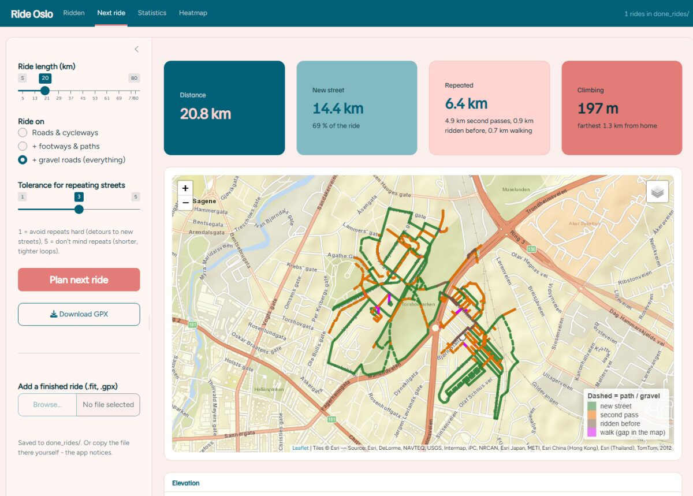
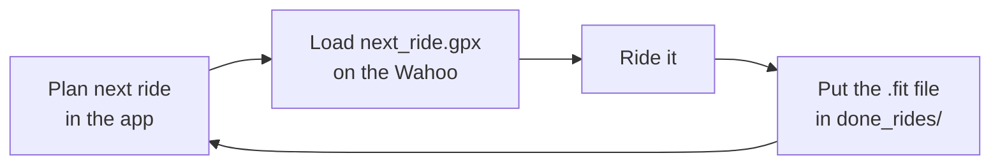
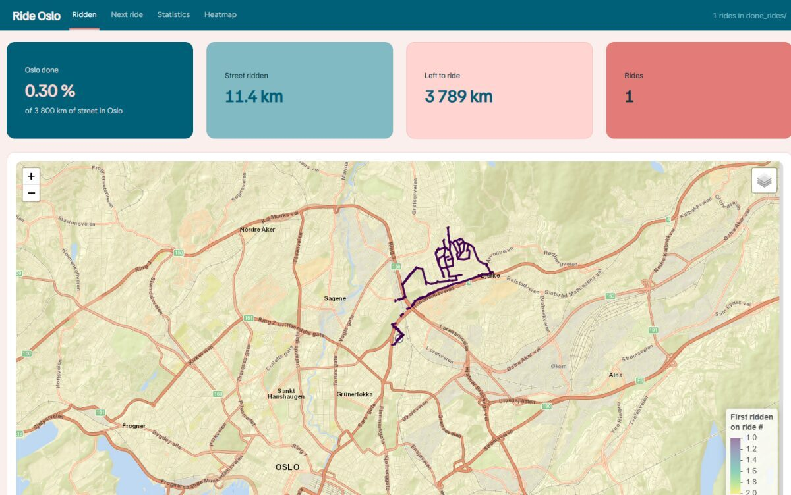
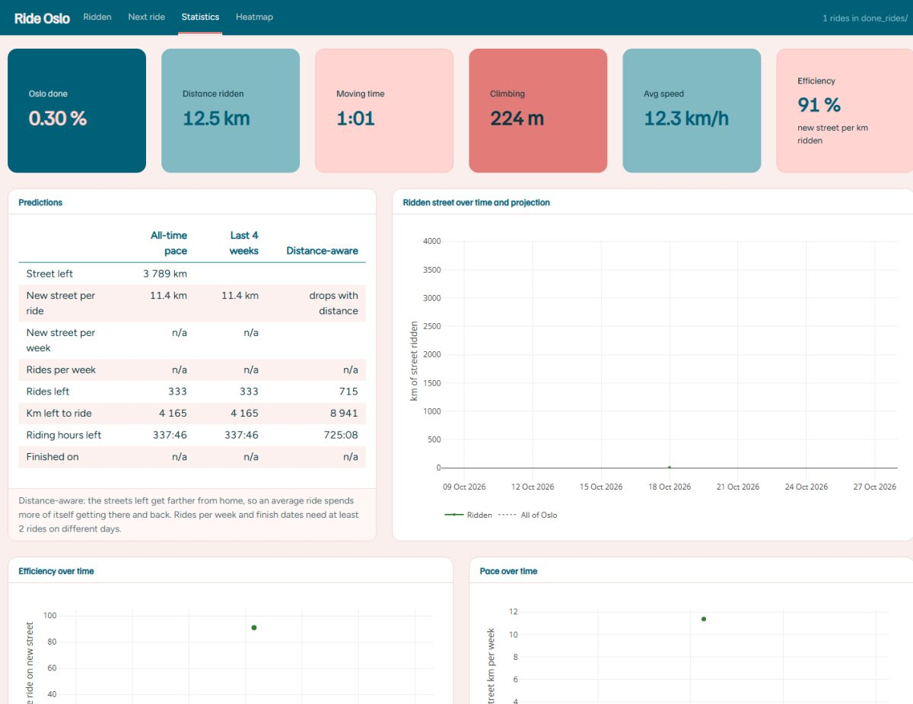
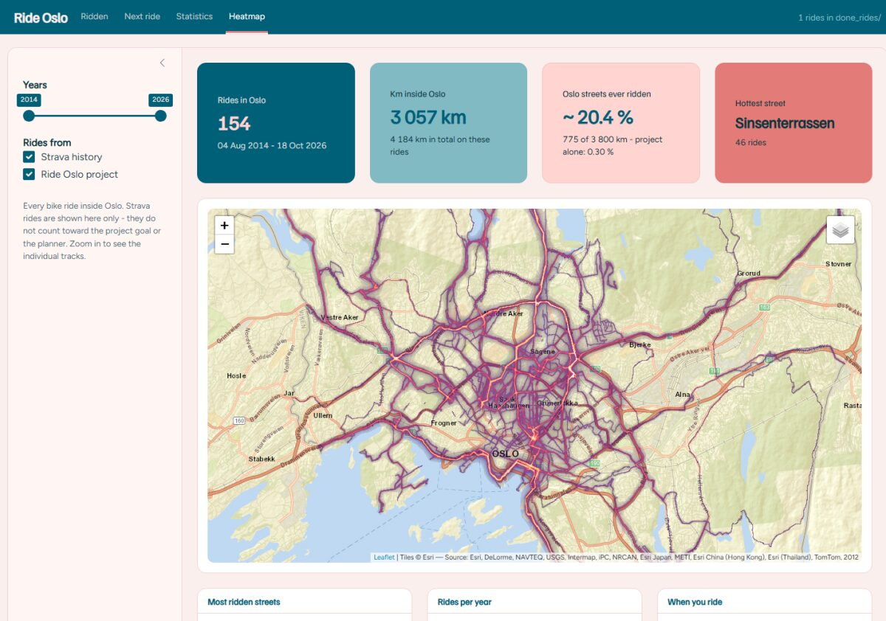
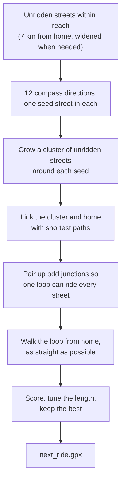

# Ride every street in Oslo

*A Shiny app that plans the next bike loop from home, one ride at a time, until every street
in Oslo has been ridden.*




Oslo has about **3,800 km** of rideable street: roads, cycleways, footways, park paths and
the gravel roads of Marka. Riding all of it by chance would take forever, because you keep
ending up on the same streets. This app keeps track of every street you have ridden and plans
a loop from home that covers as much *new* street as possible, with as little repetition as
possible, close to home. After each ride you drop the file from the bike computer into a
folder, plan again, and the map fills in.

**Contents:** [Getting started](#getting-started) ·
[One ride, start to finish](#one-ride-start-to-finish) · [The app](#the-app) ·
[How the planning works](#how-the-planning-works) · [Predictions](#predictions) ·
[The heatmap](#the-heatmap) · [Project layout](#project-layout) ·
[Updating the map data](#updating-the-map-data)

---

## Getting started

Open `ride_oslo.Rproj` in RStudio, then start the app:

```r
shiny::runApp()
```

The first start builds the Oslo street network from OpenStreetMap, which takes a few minutes.
After that it is cached and the app opens in seconds.

Prefer a script? This does the same planning with the settings in `R/config.R` and writes
`next_ride/next_ride.gpx`:

```r
source("plan_next_ride.R")
```

<details>
<summary>Setting up on a new computer</summary>

The repository holds only the code. On a fresh machine you also need:

1. **R packages:** `sf`, `igraph`, `nbpMatching`, `dplyr`, `leaflet`, `elevatr`, `terra`,
   `shiny`, `bslib`, `plotly`, `DT`, and `FITfileR` from GitHub:

   ```r
   install.packages(c("sf", "igraph", "nbpMatching", "dplyr", "leaflet", "elevatr", "terra",
                      "shiny", "bslib", "plotly", "DT", "remotes"))
   remotes::install_github("grimbough/FITfileR")
   ```

2. **Map data:** see [Updating the map data](#updating-the-map-data).
3. **Your rides:** copy `done_rides/` (and `data/strava/` for the heatmap). They are kept out
   of git on purpose, because GPS tracks show where you live.

</details>

---

## One ride, start to finish



1. On **Next ride**, choose a length and what to ride on, and press **Plan next ride**.
2. **Download GPX** and load it on the bike computer.
3. Ride.
4. Upload the recorded `.fit` file in the app, or copy it into `done_rides/` yourself. The app
   notices new files within a couple of seconds.
5. Plan again. The streets you just rode now count as done.

`done_rides/` is the whole history. Delete a file and its streets count as unridden again.

---

## The app

### Ridden

Every street you have ridden, coloured by the ride that covered it first, with your overall
progress on top. The layer menu adds what is still left, progress per district, the raw GPS
tracks and the few streets the map data cannot reach.



### Next ride

The planner. Set the **ride length**, choose to **ride on** roads only, roads and paths, or
everything including gravel, and set your **tolerance for repeating streets**. The route map
shows new street in green, second passes in orange, streets ridden before in brown, and short
walks where the map data has a gap in purple; dashed lines are paths or gravel. Hover the
elevation profile to see where you are on the route.

### Statistics

Totals, the projection to the finish, how efficient each ride was, your weekly pace, progress
per district and per way type, and every ride in a table.



### Heatmap

Every bike ride inside Oslo since 2014, from the Strava history and the project together,
drawn as a glow: the more often a street was ridden, the brighter it burns. With your most
ridden streets, rides per year, when in the year you ride, km per district and a few records.
Strava rides are only shown here. They never count toward the project.



---

## How the planning works

### The streets that count

The goal is every street in Oslo municipality in OpenStreetMap that you can reasonably ride a
bike on. The Oslo border and the 16 districts come from the same OpenStreetMap file; everything
inside Oslo but outside the districts is grouped as **Marka**.

<details>
<summary>The street rules in detail (<code>way_filter()</code> in <code>R/network.R</code>)</summary>

- **In:** public roads except motorway, trunk and primary; service roads except driveways and
  parking aisles; cycleways; footways and pedestrian streets that are not sidewalks or
  crossings; paths that are paved, gravel or compacted, or signed for bikes; tracks of grade
  1-2 or with a paved, gravel or compacted surface.
- **Out:** steps, ways signed `bicycle=no` or `dismount`, private ways, and trails (dirt or
  ground surfaces, `mtb:scale` 1 or higher, tracktype grade 3-5).
- **Untagged paths and tracks** count in the city. In Marka they are most likely forest
  trails, so there they need a good surface or bike signs.
- Ways within 1 km outside the border are kept so a route can cut through, but only streets
  whose midpoint lies inside Oslo count toward the goal.

</details>

OpenStreetMap draws streets as separate lines that cross without being connected, so the
lines are joined into a proper network first: every crossing becomes a junction, dead ends
that stop within 2 m of another street are connected to it, and a bridge is not connected to
the street underneath it. Small pieces that float free are linked to the network with a short
walk of at most 60 m. That gives about 3,800 km of street to ride; 56 km is cut off and listed
as unreachable.

### What counts as ridden

Every street gets a point about every 10 m. A street counts as ridden once **80 %** of its
points lie within **12 m** of one of your recorded tracks. Rides are applied in date order, so
each street remembers the ride that covered it first, and the new street per ride adds up to
your total.

### Planning a loop

The planner looks for a closed loop from home, of about the chosen length, that rides as much
unridden street as possible, repeats little and stays near home. Finding the best such loop
is a classic hard problem, the *Rural Postman Problem*, with no fast exact solution. So the
planner (`R/planner.R`) builds a dozen good candidates and keeps the best one:



1. **Seeds.** Around home, the compass is split into 12 directions. In each, the seed is the
   unridden street closest to home, nudged toward places where many unridden streets lie
   together, so the loop does not start on an isolated stub.
2. **Clusters.** From each seed, unridden streets are added, closest first with a pull toward
   home, until there is enough street for the ride. A first guess allows for the ride being
   about 1.35 times longer than the streets themselves, because of links and repeats.
3. **Linking.** The separate pieces of the cluster, and home, are joined with shortest paths.
   These links prefer unridden streets (35 % cheaper than ridden ones), so getting from one
   piece to the next picks up new street on the way. Paths cost a little more than roads as
   links, and walks and ways outside your chosen mode cost a lot more.
4. **Closing the loop.** A loop that rides every street exactly once only exists if an even
   number of streets meets at every junction. The odd junctions are paired up as cheaply as
   possible and the path between each pair is ridden twice. Dead ends ridden in and back out
   come from here too; together they are the **second passes** on the map.
5. **Walking it.** Any order of riding these streets gives the same distance, so the planner
   picks the order that keeps going straight ahead at junctions. The result is a ride that
   flows instead of zig-zagging.
6. **Choosing.** Each candidate gets a score, measured in kilometres:

   ```math
   \text{score} = \text{new km} \;-\; w_{\text{repeat}} \times \text{repeated km} \;-\; 0.4 \times \text{mean distance from home of the new km}
   ```

   The three best candidates are tuned until the loop is within 8 % of the wanted length, and
   the highest score wins. Elevation is added from open terrain data and the route is written
   to `next_ride/next_ride.gpx`.

**Tolerance for repeating streets** in the app sets $w_{\text{repeat}}$: positions 1 to 5 give
1.0, 0.75, 0.5, 0.3 and 0.15. Low tolerance makes longer detours to avoid riding a street
twice; high tolerance gives tighter, shorter loops. All other weights are in `R/config.R`.

---

## Predictions

The Statistics page estimates how much is left and when you will be done, in three ways:

| | How it works |
|---|---|
| **All-time pace** | Keeps your average so far: new street per ride, the share of each ride that is new street, and rides per week. |
| **Last 4 weeks** | The same, from recent rides only, so it follows your current form. |
| **Distance-aware** | The streets left get farther from home, and every ride has to get there and back. It measures how much new street you find on the part of a ride spent exploring, then simulates average rides working outward from home, each spending twice the distance to the next unridden street on getting there and back. |

Early on the three agree. Later the distance-aware estimate is the realistic one: with one ride
done it already expects about twice as many rides as the simple estimate (715 against 333).
Rides per week and finish dates appear once there are rides on two different days.

---

## The heatmap

All bike rides from the Strava history (`data/strava/`) and the project rides are clipped to
Oslo and drawn on a 20 m grid. Each cell counts how many rides passed through it, on a log
scale so the streets you ride every week do not drown out the rest, and two soft blurs on top
give the glow.

For the street statistics a ride counts as having passed a street when half of it lies within
20 m of the track. That is looser than the project rule, because the old Strava files are
simplified outlines that cut corners. That is also why "Oslo streets ever ridden" is shown with
a ~. The project's own progress always uses the strict rule.

---

## Project layout

| | |
|---|---|
| `app.R` | The Shiny app: Ridden, Next ride, Statistics and Heatmap. |
| `plan_next_ride.R` | Plans the next ride without the app. |
| `R/` | The engine: `config.R` (all settings), `network.R`, `rides.R`, `planner.R`, `stats.R`, `heatmap.R`, `export.R`, `osm_extract.R`. |
| `www/ride.css` | The app's look: colours and type. |
| `tests/testthat/` | Unit tests. Run with `source("R/setup.R"); testthat::test_dir("tests/testthat")`. |
| `done_rides/` | Your project rides (`.fit`, `.gpx` or `lat,lon` `.csv`). Not in git. |
| `next_ride/` | Always exactly one file: `next_ride.gpx`. Not in git. |
| `data/` | Map data and caches, plus `strava/` for the heatmap. Not in git. |
| `legacy_scripts/` | Earlier versions of the planner, kept for reference. |

---

## Updating the map data

Download a fresh `norway-latest.osm.pbf` from
[Geofabrik](https://download.geofabrik.de/europe/norway.html), then in R:

```r
source("R/setup.R"); source("R/osm_extract.R")
extract_oslo("path/to/norway-latest.osm.pbf")
```

Then raise `network_version` in `R/config.R` so the network is rebuilt on the next start. Do
the same after changing the street rules in `way_filter()`.

---

<sub>Map data © OpenStreetMap contributors. Background maps by Esri, CyclOSM and OpenStreetMap.</sub>
